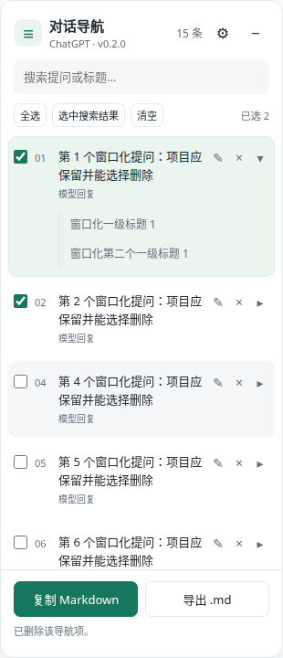

# 对话导航 · ChatGPT

在 ChatGPT 网页右侧添加按用户提问组织的目录，支持单击定位、自定义标题、删除导航项、折叠的回复一级标题导航，以及多选回复复制 / 导出 Markdown。

**当前版本：v0.2.0。当前交付形式：Chrome / Firefox 浏览器扩展（Manifest V3）。**

- 运行网站：`https://chatgpt.com/*`、旧域名 `https://chat.openai.com/*`。
- DeepSeek、Claude：已预留适配接口，尚未启用。
- 油猴 / Tampermonkey：当前还没有 `.user.js` 构建，扩展 ZIP 不能直接安装为油猴脚本。适配与发布步骤见 [油猴发布指南](docs/userscript-publishing.md)。
- 项目使用 MIT 许可，见 [LICENSE](LICENSE)。

这是在浏览器中执行的内容脚本项目。**源码构建完成后，加载到浏览器即可运行，不需要启动本地 Web 服务。**

## 目录

- [1. 功能与界面](#1-功能与界面)
- [2. 从仓库克隆到本地运行](#2-从仓库克隆到本地运行)
- [3. 在 Chrome 和 Firefox 中安装](#3-在-chrome-和-firefox-中安装)
- [4. 从发布包安装](#4-从发布包安装)
- [5. 使用说明](#5-使用说明)
- [6. 开发和重新加载](#6-开发和重新加载)
- [7. 运行真实浏览器测试](#7-运行真实浏览器测试)
- [8. 构建和打包](#8-构建和打包)
- [9. 常见问题](#9-常见问题)
- [10. 数据、权限和限制](#10-数据权限和限制)
- [11. 项目结构与平台适配](#11-项目结构与平台适配)
- [12. 分享和发布](#12-分享和发布)

## 1. 功能与界面

| 功能 | 行为 |
| --- | --- |
| 提问目录 | 按会话顺序列出已识别的用户提问，搜索同时匹配原提问和自定义标题 |
| 单击定位 | 重新获取当前消息节点，立即定位，并校正随后发生的布局变化 |
| 完整目录 | 整理窗口化页面中的消息，保留暂时退出 DOM 的项目、选区和已读取回复 |
| 独立滚轮 | 在导航面板中上下滚动；到达边界后不继续带动会话页面 |
| 自定义标题 | 单独修改 / 恢复提问导航文字，按会话保存 |
| 删除导航项 | 删除目录中的项目，刷新后保留删除状态；原始对话保留，无手动添加入口 |
| 回复 H1 子导航 | 提问后展开该问题对应模型回复的一级标题，默认关闭；子项只读且可定位 |
| Markdown | 多选问题，按对话顺序连续复制模型回复，或下载 `.md` 文件 |
| 界面 | 支持收起、深色主题、窄屏，以及自动 / 兼容模式 |

下面是使用测试会话的界面截图，展示展开一级标题、勾选回复和删除第 3 个导航项后的状态：



## 2. 从仓库克隆到本地运行

### 2.1 准备工具

| 工具 | 什么时候需要 | 要求 |
| --- | --- | --- |
| Git | 克隆源码 | 能使用 `git clone` |
| Node.js / npm | 安装依赖和构建 | **Node.js 22 或更新版本**，随 Node 安装 npm |
| Chrome 或 Firefox | 实际使用插件 | 桌面浏览器；Firefox manifest 最低版本为 142 |
| `zip` | `npm run package`、Firefox 自动化测试 | 命令需要在 PATH 中；只构建 / 手动加载扩展时不需要 |
| GeckoDriver | Firefox 自动化测试 | 与 Firefox 兼容，并支持 `--allow-system-access` |
| Playwright Chromium | Chromium 自动化测试 | 安装命令见第 7 节 |

安装参考：[Git](https://git-scm.com/downloads)、[Node.js](https://nodejs.org/en/download)、[Firefox](https://www.mozilla.org/firefox/)、[GeckoDriver 官方发布页](https://github.com/mozilla/geckodriver/releases)。

先确认终端可用：

```bash
git --version
node --version
npm --version
```

Node 必须达到 22：锁定的 Selenium 依赖要求 Node 22，不能只看某个构建工具支持的较低版本。

目前完整自动化流程在 Linux 上验证。Windows / macOS 可按下面的通用步骤构建并在浏览器中手动加载；完整自动化涉及驱动路径、ZIP 命令和键盘平台差异，其他系统尚未独立验证。

### 2.2 克隆并构建

```bash
git clone https://github.com/Jin-Yi-Liang/chatgpt_plugins.git
cd chatgpt_plugins
npm ci
npm run build
```

命令的作用：

1. `git clone` 获取源码，`cd` 进入包含 `package.json` 的项目根目录。
2. `npm ci` 按 `package-lock.json` 安装固定版本依赖。
3. `npm run build` 生成 Chrome 和 Firefox 两个扩展目录。

预期输出：

```text
Built dist/chrome and dist/firefox
```

构建后应该存在：

```text
dist/
├── chrome/
│   ├── manifest.json
│   ├── content.js
│   ├── popup.html
│   ├── popup.js
│   ├── LICENSE
│   └── THIRD_PARTY_NOTICES.txt
└── firefox/
    └── 同样的文件，manifest 包含 Firefox 专用字段
```

**刚克隆时没有 `node_modules/`、`dist/` 或 `artifacts/` 是正常情况。** 它们是生成目录，被 `.gitignore` 忽略。不能在执行构建前选择不存在的 `dist/chrome`；也不要把项目根目录当成扩展目录。

## 3. 在 Chrome 和 Firefox 中安装

### Chrome

1. 在地址栏打开 `chrome://extensions/`。
2. 打开右上角“开发者模式”。
3. 点击“加载已解压的扩展程序”。
4. 选择本次构建的 **`chatgpt_plugins/dist/chrome` 目录**。
5. 确认扩展名称为“对话导航 · ChatGPT”，版本为 `0.2.0`。
6. 打开或刷新 ChatGPT 标签页，进入一个已有会话。
7. 页面右侧应出现导航面板，副标题为 `ChatGPT · v0.2.0`。

### Firefox

1. 在地址栏打开 `about:debugging#/runtime/this-firefox`。
2. 点击“临时载入附加组件”。
3. 选择 **`chatgpt_plugins/dist/firefox/manifest.json`**。
4. 如浏览器要求站点访问许可，允许访问 ChatGPT。
5. 打开或刷新 ChatGPT 标签页，进入已有会话。
6. 页面右侧应出现导航，副标题为 `ChatGPT · v0.2.0`。

当前本地 Firefox 包尚未经过 Mozilla 签名。临时附加组件在浏览器重启后需要重新加载。长期安装 / 正式分发的签名方式参见 [Mozilla 签名与分发说明](https://extensionworkshop.com/documentation/publish/signing-and-distribution-overview/)。

### 初次手动验收

建议用一个无敏感信息的测试会话依次检查：

1. 目录能显示提问，点击首、中、末条目可以定位。
2. 改写一个标题并保存，刷新后标题仍保留。
3. 提问数量较多时，滚轮能浏览目录上方和下方。
4. 删除一个导航项，原对话消息仍在，刷新后导航项仍删除。
5. 让模型回复包含 Markdown `# 一级标题`，展开 `▸` 并点击子标题定位。
6. 勾选两条不相邻问题，复制到文本编辑器；下载 `.md` 并确认内容顺序一致。

## 4. 从发布包安装

如果作者在 [GitHub Releases](https://github.com/Jin-Yi-Liang/chatgpt_plugins/releases) 提供对应版本 ZIP，可以直接下载，无需安装 Node 或自行构建。**GitHub 的“Download ZIP”是源码包，不等同于扩展发布包。** 尚无 Release 时，使用第 2 节从源码构建。

- Chrome：下载 `conversation-navigator-chrome-<版本>.zip`，解压，加载包含 `manifest.json` 的解压目录。
- Firefox：下载 `conversation-navigator-firefox-<版本>.zip`，解压，临时载入其中的 `manifest.json`。

这些 ZIP 是浏览器扩展包，不是油猴脚本。当前项目没有 `.user.js` 安装链接。

## 5. 使用说明

| 控件 | 用法 |
| --- | --- |
| 提问文字 | 单击定位到该提问 |
| `✎` | 编辑自定义标题；“保存”或 `Ctrl/⌘ + Enter` 保存，`Esc` 取消 |
| “恢复原提问” | 取消当前项目的自定义标题 |
| `×` | 删除当前导航项，不删除对话；删除状态按会话保存 |
| `▸` / `▾` | 展开 / 收起对应回复的 H1 标题；默认关闭 |
| H1 子项 | 点击定位到回复标题，仅支持跳转 |
| 搜索框 | 匹配原始提问与自定义标题 |
| “全选” | 选择整个目录中的问题，不含已删除项目 |
| “选中搜索结果” | 将当前搜索结果加入选区 |
| “清空” | 取消全部勾选 |
| “复制 Markdown” | 合并所选问题的模型回复，复制到剪贴板 |
| “导出 .md” | 下载同一份合并内容 |
| `⚙` | 设置导出标题、页面适配模式，重置本会话自定义标题 |
| `−` / “对话导航”浮动按钮 | 收起 / 展开面板 |

页面快捷键：`Alt + Shift + N`。浏览器工具栏扩展按钮也提供显示 / 收起操作。

合并顺序始终按原会话顺序，与勾选顺序无关。同一问题对应多个已读取的模型回复时连续合并。默认仅输出回复正文，以 `---` 分隔；设置中开启“导出包含提问 / 自定义标题”后，给每份回复添加二级标题。

如果所选问题暂无回复，或最后一份所选回复仍在生成，会提示等待或取消勾选。勾选状态和 H1 展开状态不永久保存，刷新 / 切换会话后重新设置。自定义标题、导航删除状态和界面偏好使用浏览器的本地扩展存储；不同浏览器之间不自动同步。

## 6. 开发和重新加载

修改源码后执行：

```bash
npm run build
```

然后：

- Chrome：在 `chrome://extensions/` 点击扩展卡片的重新加载按钮，再刷新 ChatGPT 标签页。
- Firefox：在 `about:debugging#/runtime/this-firefox` 点击该扩展的“重新载入”，再刷新 ChatGPT 标签页。

仅重新构建磁盘文件不会替换已有标签页里已注入的旧脚本。可以根据面板副标题确认版本。

日常建议修改 `src/` 和 `scripts/`。`dist/` 是构建输出，直接修改会在下一次构建时覆盖。

所有命令都从项目根目录运行。这里没有 `npm start`：浏览器负责运行构建后的脚本。

## 7. 运行真实浏览器测试

### 7.1 先准备 Chromium

完成 `npm ci` 后：

```bash
npx playwright install chromium
```

Linux 如提示缺少系统动态库，可根据 [Playwright 官方安装说明](https://playwright.dev/docs/browsers) 使用：

```bash
npx playwright install --with-deps chromium
```

`--with-deps` 会安装系统依赖，可能要求管理员权限。仅希望测试 Chromium 时：

```bash
TEST_BROWSERS=chromium npm test
```

PowerShell 对应写法：

```powershell
$env:TEST_BROWSERS = "chromium"
npm test
Remove-Item Env:TEST_BROWSERS
```

测试使用 Playwright 对应版本的 Chrome for Testing。只安装日常使用的 Google Chrome 不能代替上述下载步骤。详见 [Playwright 扩展测试文档](https://playwright.dev/docs/chrome-extensions)。

### 7.2 准备 Firefox 与 GeckoDriver

Firefox 测试由 Selenium / GeckoDriver 驱动系统 Firefox，不使用 Playwright 的 Firefox 引擎。需要安装真实 Firefox 和 [GeckoDriver](https://github.com/mozilla/geckodriver/releases)，并确保有 `zip` 命令。

当前 Ubuntu Snap 环境的默认路径：

```text
FIREFOX_BINARY=/snap/firefox/current/usr/lib/firefox/firefox
GECKODRIVER=/snap/bin/geckodriver
```

其他 Linux 安装方式需显式指定真实路径。例如下面假设 Firefox 在 `/usr/bin/firefox`、GeckoDriver 在 `/usr/local/bin/geckodriver`；若实际安装位置不同，应替换：

```bash
FIREFOX_BINARY=/usr/bin/firefox \
GECKODRIVER=/usr/local/bin/geckodriver \
TEST_BROWSERS=firefox npm test
```

macOS 的 Firefox 二进制通常位于 `/Applications/Firefox.app/Contents/MacOS/firefox`。Windows 应设置完整的 `firefox.exe` / `geckodriver.exe` 路径。原生 Windows 下还必须让 `zip` 命令可用；第 8 节的 PowerShell 压缩方式只替代发布打包，不替代 Firefox 测试内部的 ZIP 操作。完整自动化优先使用已验证的 Linux 环境。

驱动必须支持 `--allow-system-access`，测试弹出页时会使用这个参数。这里只启动隔离的测试配置，不连接日常 Firefox 配置。

### 7.3 完整流程与预期结果

准备好 Chromium、Firefox、GeckoDriver 和 `zip` 后：

```bash
npm test
npm run lint
npm run package
```

`npm test` 会先构建，再启动两个真实 headless 浏览器并安装扩展。当前完整测试每个浏览器 **27 组**；通过后 `artifacts/tests/report.json` 的顶层 `passed` 应为 `true`，命令退出码为 0。

测试覆盖实际点击、单击即时与稳定后坐标、动态重排、窗口化目录、原生滚轮和键盘、标题 / 删除持久化、只读 H1 导航、剪贴板粘贴、文件下载、搜索、多选、会话切换、主题和窄屏。

| 文件 | 用途 |
| --- | --- |
| `artifacts/tests/report.json` | 每组结果、浏览器版本、定位坐标、构建哈希 |
| `artifacts/tests/*-clipboard.md` | 实际剪贴板粘贴后的文字 |
| `artifacts/tests/*-export.md` | 浏览器实际下载的 Markdown |
| `artifacts/tests/*.png` | 运行截图；失败时可能包含诊断截图 |
| [v0.2.0 验收记录](docs/verification-0.2.0.md) | 已提交到 Git 的历史验收说明 |
| [v0.2.0 验收数据](docs/verification-0.2.0.json) | 已提交到 Git 的历史结果与哈希 |

自动化会话使用测试数据：Chromium 拦截测试域名请求，Firefox 使用临时测试匹配规则和浏览器独立的本地代理。生产包没有这些测试配置。结束后关闭浏览器并清理临时配置。

真实站点的独立访问检查另行执行：

```bash
npm run test:live
```

该命令会访问真实 ChatGPT；若匿名页面提供输入框，会发送一条格式测试问题。登录 / 人机验证等阻塞记录在 `artifacts/live/report.json`，不等同于完整功能通过。自动化验收与真人现场使用应分别记录。项目使用者已于 **2026-10-13** 反馈 Firefox 和 Chrome 现场测试正常。

### 7.4 调试测试选项

| 环境变量 | 作用 |
| --- | --- |
| `TEST_BROWSERS=chromium` / `firefox` | 只运行一个浏览器，默认两者都运行 |
| `FIREFOX_BINARY` | 覆盖 Firefox 二进制路径 |
| `GECKODRIVER` | 覆盖 GeckoDriver 路径 |
| `TEST_ARTIFACT_DIR` | 覆盖报告和截图目录 |
| `TEST_EXTENSION_ROOT` | 测试另一份已构建目录，下面应有 `chrome/` 和 `firefox/` |
| `TEST_ONLY_NAVIGATION=1` | 仅调试新增导航相关测试，不代表完整验收 |

调试选项会减少测试范围，发布前应去掉限制并执行完整 `npm test`。

从公开仓库重新克隆并执行安装、构建、打包及双浏览器测试的独立验证摘要见 [本地流程验证](docs/local-setup-check.md)。

## 8. 构建和打包

| 命令 | 作用 |
| --- | --- |
| `npm ci` | 安装锁文件中的依赖 |
| `npm run build` | 生成 `dist/chrome` 和 `dist/firefox` |
| `npm test` | 构建并执行浏览器集成测试 |
| `npm run lint` | 检查已构建的 Firefox 扩展，警告也会导致失败 |
| `npm run package` | 重新构建并用系统 `zip` 生成两个发布 ZIP |
| `npm run test:live` | 独立访问真实 ChatGPT，记录网站访问范围与阻塞 |

`npm run lint` 本身不会构建。首次使用应先执行 `npm run build` 或 `npm test`。

Linux / macOS 打包：

```bash
npm run package
```

当前版本输出：

```text
artifacts/packages/conversation-navigator-chrome-0.2.0.zip
artifacts/packages/conversation-navigator-firefox-0.2.0.zip
```

Windows 如果没有 `zip`，可以先构建再用 PowerShell 压缩；注意压缩的是扩展目录的**内容**，ZIP 根目录应直接包含 `manifest.json`：

```powershell
npm run build
$NavigatorVersion = (Get-Content package.json -Raw | ConvertFrom-Json).version
New-Item -ItemType Directory -Force artifacts/packages | Out-Null
Compress-Archive -Path dist/chrome/* -DestinationPath "artifacts/packages/conversation-navigator-chrome-$NavigatorVersion.zip" -Force
Compress-Archive -Path dist/firefox/* -DestinationPath "artifacts/packages/conversation-navigator-firefox-$NavigatorVersion.zip" -Force
```

版本号来自 `package.json`，构建时同步写入两个 manifest 和面板。更新依赖时同时提交 `package.json` 与 `package-lock.json`。打包会附带本项目 LICENSE 和 Markdown 转换库的授权说明。

## 9. 常见问题

| 现象 | 检查与处理 |
| --- | --- |
| 没有 `dist/` 或找不到 manifest | 在包含 `package.json` 的根目录执行 `npm ci`、`npm run build` |
| `EBADENGINE` / Node 版本不兼容 | 使用 Node 22 或更新版本，再执行 `npm ci` |
| `spawn zip ENOENT` | 安装 / 提供 `zip`；只做手动加载时不必运行打包或 Firefox 自动化 |
| Playwright 提示浏览器 executable 不存在 | 在项目根目录执行 `npx playwright install chromium` |
| Firefox / GeckoDriver 路径不存在 | 使用本机路径设置两个环境变量，不能照搬 Ubuntu Snap 路径 |
| 缺少 Linux 浏览器动态库 | 按 Playwright 官方说明安装系统依赖 |
| 导航面板没有出现 | 检查加载目录、站点权限；重新载入扩展并刷新 ChatGPT 标签页 |
| 目录为 0 条 | 确认会话正文已加载、面板版本正确；尝试兼容模式，仍失败时附浏览器版本及脱敏结构反馈 |
| 首次整理目录时页面短暂空白 | 整理时短暂隐藏快速跳动的正文；完成后恢复，手动操作可中断 |
| H1 展开按钮灰色 | 当前回复没有已识别的 H1；H2/H3 不会作为一级标题显示 |
| 刷新后被删的项目仍未出现 | 这是按会话保存的导航删除状态，不是原始消息被删除 |
| 自己的 `.md` 找不到 | 检查浏览器下载记录和默认下载目录 |
| ZIP 无法用油猴安装 | 当前 ZIP 是浏览器扩展包；油猴需要单独适配后的 `.user.js` |

## 10. 数据、权限和限制

| 权限 | 用途 |
| --- | --- |
| ChatGPT 两个域名的站点访问 | 自动注入脚本，读取会话 DOM |
| `storage` | 保存会话标识、自定义标题、删除标识和界面偏好 |
| `clipboardWrite` | 用户点击复制后写入 Markdown，不读取剪贴板 |

项目不调用 ChatGPT 私有 API，不包含遥测、后台服务器或远程执行代码。整份默认提问与回复不永久写入扩展存储；本页内存中保留已读取目录及回复，刷新后重新读取。用户将完整提问主动保存成自定义标题时，该标题会进入本地存储。

Markdown 支持标题、段落、强调、列表、引用、链接、图片、代码块、表格、删除线和 KaTeX 公式。代码保留语言与换行，表格转义竖线和换行，公式保留 LaTeX。图片仅保留 URL，不下载图片，带有效期的链接可能过期。

会话整理最多运行 25 秒，手动操作可中断；正常滚动后继续合并已发现项目。服务端没有加载的历史消息、隐藏分支、复杂图表 / Canvas 等内容无法保证完整读取。ChatGPT 页面结构变化可能需要更新适配器。

## 11. 项目结构与平台适配

```text
chatgpt_plugins/
├── src/                 # 浏览器中执行的源码
├── scripts/             # 构建、发布 ZIP 脚本
├── tests/               # 浏览器驱动与模拟会话
├── docs/                # 验收记录、界面图片、油猴发布指南
├── package.json         # 项目版本和 npm 命令
├── package-lock.json    # 固定依赖版本
├── LICENSE
├── dist/                # 构建后生成，不提交 Git
└── artifacts/           # ZIP、运行报告和截图，不提交 Git
```

| 源码 | 职责 |
| --- | --- |
| `src/platforms.js` | 平台选择、消息识别、提问 / 回复配对、稳定键 |
| `src/content.js` | 导航 UI、事件、标题与删除、选择和导出 |
| `src/navigation.js` | 定位、反向滚动、重排校正及用户接管 |
| `src/inventory.js` | 合并消息窗口、保留目录、H1 子项与位置提示 |
| `src/discovery.js` | 挂载未显示消息、整理目录、恢复视图 |
| `src/markdown.js` | DOM 转 Markdown、代码 / 表格 / 公式规则 |
| `src/storage.js` | Firefox `browser` / Chrome `chrome` API |
| `src/panel.css` | Shadow DOM 内样式 |
| `src/popup.*` | 浏览器工具栏弹出页 |
| `scripts/build.mjs` | 生成两份 Manifest V3 扩展 |
| `scripts/package.mjs` | 按项目版本生成 ZIP |

新增平台时实现 `matches(location)`、`collect(document, mode)`、`conversationKey(location, turns)`，每轮返回 `{ key, prompt, anchor, answers }`。然后启用适配器、增加对应站点权限和真实页面结构测试。DeepSeek / Claude 占位接口不是已经完成的功能，当前发布包只申请 ChatGPT 权限。

## 12. 分享和发布

给愿意构建源码的人发送 [仓库链接](https://github.com/Jin-Yi-Liang/chatgpt_plugins)，按第 2～3 节即可运行。给只希望安装的人提供构建好的版本 ZIP 及第 4 节说明；如果后续完成油猴版本，再提供脚本安装页。

GitHub 源码、浏览器扩展商店、油猴脚本是不同的分发形式。当前仓库实现了前两种浏览器的本地扩展构建，尚未提供油猴脚本。**油猴适配、Greasy Fork 发布、版本更新和发布前测试的详细步骤见 [油猴发布指南](docs/userscript-publishing.md)。**

反馈建议包含浏览器 / 扩展版本、复现步骤、会话长度和脱敏截图或结构信息。不要把聊天正文、登录凭据或访问令牌提交到公开 Issue。

参考：[Chrome 内容脚本](https://developer.chrome.com/docs/extensions/develop/concepts/content-scripts)、[Firefox manifest](https://developer.mozilla.org/en-US/docs/Mozilla/Add-ons/WebExtensions/manifest.json/browser_specific_settings)、[Playwright 扩展测试](https://playwright.dev/docs/chrome-extensions)、[Selenium Firefox](https://www.selenium.dev/documentation/webdriver/browsers/firefox/)。
