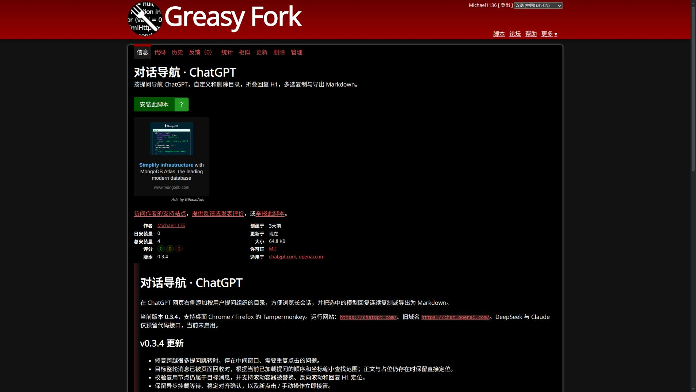

# v0.3.4 远距离导航修复

功能验收：2026-10-16；公开发布及分发验收：2026-10-18，Asia/Shanghai。分支 `fix/distant-navigation`，基于 `e9bb596`，实现提交 `043ddb2`。本轮推送修复分支，保留 main。

## 原因与修复

用户报告：Firefox 相邻项目跳转迅速，但跨越很远的项目时，页面经常移动到中间就停止。

v0.3.3 对已挂载消息和仍有占位节点的消息会直接定位；**目标整轮消息及占位均离开 DOM** 时，先使用历史坐标，随后每次仅沿目标方向移动约 0.8 个视口。长回复加载后消息高度变化，历史坐标可能过期几十万像素。逐屏探测无法在 12 秒内覆盖这样的距离，所以相邻跳转正常、远跳超时。

另一个缺口是仅凭节点仍连接到文档且有尺寸判断目标有效。虚拟列表复用 DOM 时，同一节点可能已经承载其他轮次；继续使用旧引用会导航到错误消息。

本轮修改：

- `inventory` 保存本次收集到的消息顺序及实时位置样本。没有目标占位时，提供当前有效滚动容器和挂载消息位置，避免依赖已经断开的容器。
- `navigation` 以当前样本缩小目标所在的坐标区间，按轮次索引插值探测；限制插值比例，避免消息高度不均时只前进很小距离。支持正向及 `column-reverse` 的负滚动坐标。
- 已挂载目标及当前占位继续直接定位。目标出现后仍须稳定对齐才报告成功；保留 12 秒等待上限、新点击和手动滚动接管。
- 提问和 H1 都检查所属轮次身份；不从已经回收的旧回复引用重新读取标题。

## 受控旧版复现

真实前台 Firefox 157，安装保存的原生 v0.3.3 ZIP。页面最初完整显示 64 轮并让插件收集目录，随后只保留连续 4 轮 DOM，删除远处轮次及占位，并非隐藏正文但保留目标位置。每轮高度从约 900～1080 px 改为 5000～42000 px，变化不均匀。

相邻点击通过；点击第 59 项后，旧版超时，14 秒采样时仍停在第 7～10 项窗口，滚动位置 114526 px，目标不存在于当前 DOM。对照报告为 `artifacts/distant-0.3.3-foreground/report.json`，每个采样均记录页面可见状态；旧版失败不会计入新版通过数量。

初次油猴专项运行还发现测试标签页被管理器欢迎页放到后台，Firefox 对绘制回调节流。测试现在在导航和点击前关闭隔离测试配置中的其他页并确认会话处于前台；没有关闭用户日常浏览器标签，也没有修改浏览器节流参数。

这证明了与报告症状一致的可重复失败路径；未直接操作用户私人 Firefox 会话。

## 验收与复现命令

```bash
npm ci
npm run build
npm run lint
npm run check:userscript
node tests/run.mjs
TEST_RUNTIME=tampermonkey node tests/run.mjs
npm run test:performance
npm run package
```

专项调试：

```bash
TEST_ONLY_DISTANT=1 node tests/run.mjs
TEST_RUNTIME=tampermonkey TEST_ONLY_DISTANT=1 node tests/run.mjs
```

新场景包括普通布局、反向布局、节点原地复用和滚动容器替换，逐一测试相邻点击、远距离往返及 H1。每次目标只点击一次，检查实际目标节点、最终偏移、状态文字和完整目录保留；最多只挂载 4 轮，防止测试退化成全量 DOM。

完整结果、逐次坐标 / 用时、交付哈希与发布链路核验见 [JSON 数据](verification-0.3.4.json)。使用真实浏览器、真实安装的原生扩展或官方 Tampermonkey，正文为模拟数据及用户提供的脱敏结构。Firefox 本地 HTTP 测试只补充匹配协议，生产主体不变；公开版本另做安装链路验证。

## 实际结果

| 运行形式 | Chrome for Testing 156.0.8078.4 | Firefox 157.0 |
| --- | --- | --- |
| 原生扩展 | 40/40 | 40/40 |
| 官方 Tampermonkey | 5.5.1，40/40 | 5.5.0，40/40 |

共 **160/160 组**。新增三组场景在四种环境共执行 56 次远距离提问 / H1 单击，全部到达实际目标；最终偏移约 24 px，容差 3 px。Firefox 油猴稳定完成用时约 **1051～1084 ms**，包含至少 1 秒完成确认；相邻定位仍使用直接对齐路径。测试用时只适用于上述固定模拟数据，不作为任意线上会话的速度保证。

标题编辑和持久化、导航删除、默认折叠且只读的 H1、搜索、真实滚轮 / 键盘、手动接管、剪贴板实际粘贴、浏览器 Markdown 下载、动态回复、会话切换、主题和窄屏均保留完整回归。web-ext lint 为 0 错误 / 0 通知 / 0 警告，userscript 元信息与隔离检查通过。1,500 条目录性能检查与 126 次窗口合并差异对照通过。

## 发布及仓库交付

2026-10-18 已更新原 [Greasy Fork 条目 600317](https://greasyfork.org/zh-CN/scripts/600317-对话导航-chatgpt) 为 v0.3.4。现有安装 URL、名称和 namespace 不变。

- 本地脚本：66,306 字节，SHA-256 `78ca255786ad71fa5e88c5e0869257f005661857c135ac43a33e755873bff284`。
- 公开文件：66,554 字节，SHA-256 `cd750d89b870c7cfbc61babc1478ede58d5ec77d74ae42fcc8ee6cb71a1c2300`。
- 去掉平台自动补入的 `@downloadURL` / `@updateURL` 两行后，线上文件与已验收本地文件逐字一致。扩展 ZIP 中的主体及 manifest 也与功能测试哈希一致。
- 真实 Chrome 从公开页完成 0.3.3 → 0.3.4 升级，旧自定义标题和删除状态保留，刷新受控 HTTPS 会话后实际点击跳转通过。
- 真实 Firefox 从公开页完成安装，管理器显示 v0.3.4；该步骤只证明公开安装链路，Firefox 完整功能由前述油猴 40 组验收。

网络波动曾造成 `ERR_NETWORK_CHANGED`，以及第三方广告资源令整页 load 等待超时。公开安装测试现以 `domcontentloaded` 为入口，并支持可选 `PUBLICATION_PROXY`。最终分发验收使用已经运行的本地 HTTP 代理，仅配置隔离浏览器；未修改系统代理、DNS 或浏览器安全校验。公开文件下载保留 TLS 证书校验，通过该代理使用 TLS 1.2 完成核验。

源码实现提交 `043ddb2` 已推送到 [远程修复分支](https://github.com/Jin-Yi-Liang/chatgpt_plugins/tree/fix/distant-navigation)，本轮保留 main。首次 HTTPS push 缺少命令行凭据，改用本机已有 SSH 授权完成推送，未修改远程 URL 或凭据。README、发布介绍、升级配置及本验收记录在同一分支交付。

原始完整报告和公开安装截图分别位于 `artifacts/tests/`、`artifacts/tests-userscript/`、`artifacts/publication-0.3.4/`；这些是本地生成目录。仓库保留可复核 JSON 与发布截图：


