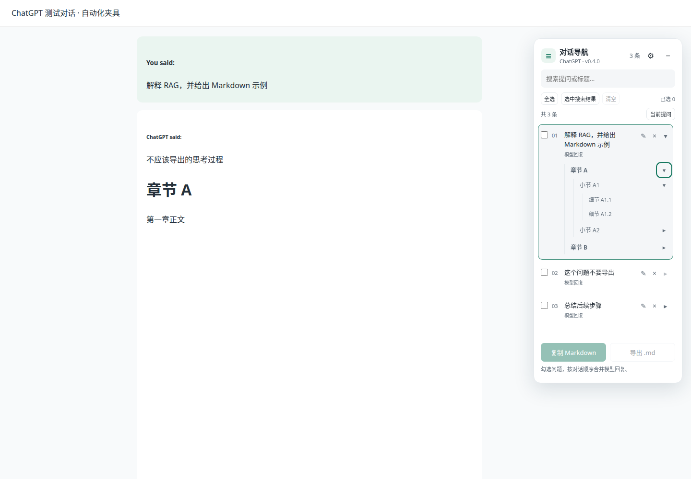
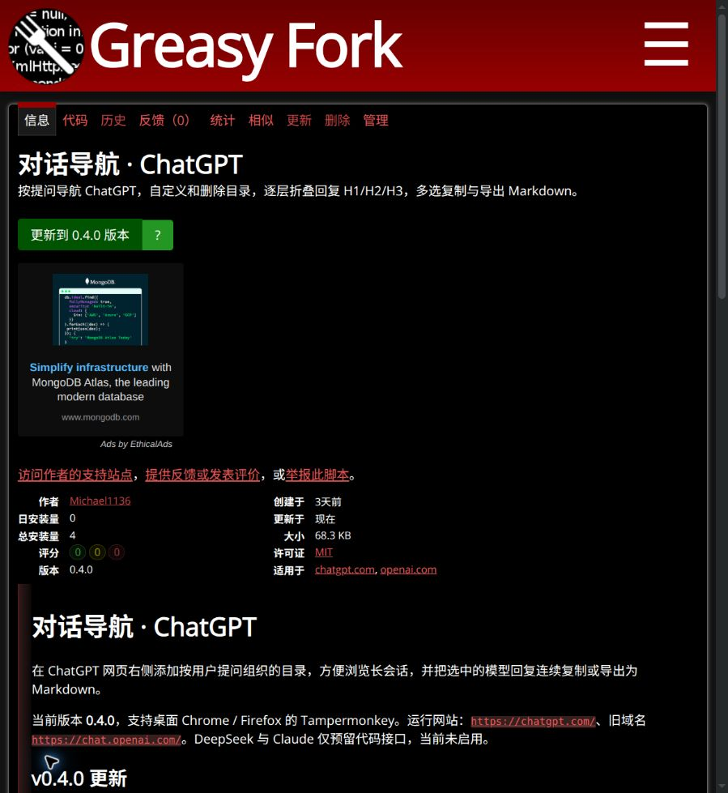

# v0.4.0 回复三级折叠目录

日期：2026-10-18，Asia/Shanghai。

## 分支整合与交付范围

工作区最初位于 `fix/distant-navigation`，提交 `bf78d3e`。核对本地与远程提交链后，`feat/tampermonkey`、`perf/navigation-experience`、`fix/userscript-navigation`、`fix/navigation-completion` 和 `fix/distant-navigation` 都已包含在该提交中。本地 `main` 从 `856316b` 快进到 `bf78d3e`，并通过已有 SSH 授权同步到远程 main；没有丢弃提交或删除旧分支。

新功能从这个 main 创建独立分支 `codex/heading-outline`。本轮要求的交付目标是本地 Git 和 Greasy Fork，因此新功能分支仅提交本地，未再次合并 main，也未推送新功能分支。

## 行为与实现

- 识别模型回复的 H1、H2、H3，按原文顺序建立父子关系。提问、H1、H2 的展开框各自初始关闭；H3 或没有子项的标题不显示无效箭头。
- 点击标题文字定位到该标题。点击箭头只展开 / 收起，不带动会话正文。标题只读，无自定义和删除入口。
- 无 H1 或跳过某一级时，把标题挂到最近的更高级标题下；没有上级时作为回复根标题，不伪造缺失标题。每份模型回复重新开始建树，避免后一份回复成为前一份回复的子标题。
- 各级控件以稳定标题键缓存，局部更新与移动标题时保留可复用节点及提问编辑器。相同文字在不同层级使用不同键。会话内收起后重开保留已展开的子树；刷新或切换会话后重新默认收起。
- 回复 H4～H6 不在目录列出，Markdown 导出仍保留原文层级。隐藏内容和思考块不进入标题目录。
- 定位继续沿用 v0.3.4 的挂载等待、实时几何校正、节点所属轮次检查、远距离区间查找和手动接管逻辑。

核心改动位于 `src/inventory.js`、`src/content.js`、`src/panel.css`。H1 继续使用原有标题键格式；新 H2/H3 键包含层级，避免同名冲突。没有新增权限、联网接口或第三方依赖。

## 验收

测试使用真实 Chrome for Testing / Firefox，分别安装本项目原生扩展和官方 Tampermonkey；正文为模拟数据及脱敏页面结构，不是用户私人会话的现场验收。

新增四组测试：

1. 逐层默认收起、独立展开、只读、键盘焦点、刷新恢复默认和窄屏宽度。
2. H1/H2/H3 实际点击定位，展开操作不导航正文。
3. 无 H1、跳级、多个模型回复、重复标题、动态父子关系变化及编辑草稿保留。
4. 64 轮目录仅保留 4 轮 DOM 并原地复用节点后，远距离单击 H2/H3 仍定位实际目标。

保留此前 40 组功能和导航回归。完整结果、浏览器版本、最终坐标、测试主体哈希、分支整合和公开升级记录见 [JSON 数据](verification-0.4.0.json)。

```bash
npm ci
npm run build
npm run lint
npm run check:userscript
node tests/run.mjs
TEST_RUNTIME=tampermonkey node tests/run.mjs
npm run test:performance
npm run package
```

仅调试新增功能：

```bash
TEST_ONLY_HEADINGS=1 node tests/run.mjs
TEST_RUNTIME=tampermonkey TEST_ONLY_HEADINGS=1 node tests/run.mjs
```

这些调试选项不能代替发布前的完整功能测试。公开安装 / 升级验证由 `tests/published-install.mjs` 从真实 Greasy Fork 页面触发；Firefox 公开检查只证明安装及管理器版本，完整功能另由本地真实油猴测试覆盖。

## 实际结果与公开发布

| 运行形式 | Chrome for Testing 156.0.8078.4 | Firefox 157.0 |
| --- | --- | --- |
| 原生扩展 | 44/44 | 44/44 |
| 官方 Tampermonkey | 5.5.1，44/44 | 5.5.0，44/44 |

最终发布文件对应的四种环境共 **176/176 组通过**。H1/H2/H3 实际跳转偏移约 16 px；窗口回收测试中 H2/H3 使用 24 px 滚动内边距，均按 3 px 容差验证。web-ext lint 0 错误 / 0 通知 / 0 警告；元信息检查通过。1,500 条目录性能检查及 126 次窗口合并差异对照通过。

实现提交为 `15c932f`。v0.4.0 已于2026-10-18更新到 [原 Greasy Fork 条目600317](https://greasyfork.org/zh-CN/scripts/600317-对话导航-chatgpt)，原安装链接、namespace 和名称不变。

- 本地油猴包69,961字节，SHA-256 `be48ef1af88754c326376d69287739d26c14366badfe57b1370109cf21d4bbcd`。
- 公开文件70,209字节，SHA-256 `65d909ca0e7bbc51bb00142e88aad51faabd70ccce45373bda27d4795be2d810`。
- 仅去掉平台补入的下载 / 更新URL两行后，公开文件与经过完整回归的文件逐字一致。两份扩展 ZIP 的主体和 manifest 也与测试文件哈希一致。
- Chrome 从公开页实际完成0.3.4→0.4.0升级，自定义标题及删除状态保留；公开安装的生产脚本在受控 HTTPS 会话中逐层展开H1/H2/H3，并实际定位到H3。
- Firefox 从公开页安装，官方油猴管理器显示0.4.0。Firefox 各功能由44组实际油猴完整回归覆盖。

公开安装测试仅为隔离测试浏览器使用已有本地HTTP代理；公开文件下载保持TLS证书校验。未修改系统代理、DNS或用户浏览器安全配置。

实际三级目录：



公开发布结果：


