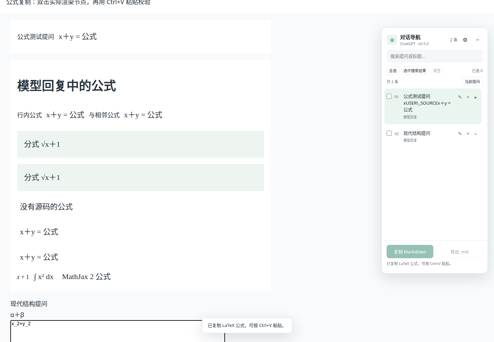

# v0.5.0 公式双击复制

日期：2026-10-18，Asia/Shanghai。独立分支 `codex/formula-copy`，基于已发布 v0.4.0 的本地提交 `9d5b730`。本轮按要求提交本地 Git 和 Greasy Fork；不合并 main，不推送新分支。

## 功能与范围

双击模型生成的可见公式，默认将完整 LaTeX 源码复制到剪贴板，随后可以 Ctrl+V 粘贴。包含行内、独立、多行、矩阵和相邻公式；原始反斜杠、花括号及换行不做 Markdown 转义。

设置中的“公式复制”可切换 LaTeX 源码与 Markdown 公式。后者按行内 `$...$` 和独立 `$$` 块输出，偏好保存在本地。面板收起时也生效，并用独立提示确认复制结果。事件委托覆盖动态新增和切换会话后的公式，不扫描全部公式或修改公式节点。

实现从 KaTeX 的 TeX annotation、MathML alttext，以及保留源码的 MathJax 数据属性 / 源脚本读取内容；不拼接有重复视觉、无障碍文本的渲染结果。图片和缺失源码的公式无法还原，显示提示并保留原剪贴板。

仅响应真实的主键双击。普通单击、页面合成事件、用户提问、代码块和输入区域不触发写入。可见的模型思考区域公式可由用户双击复制；隐藏内容不可触发。只写剪贴板，不读取剪贴板，沿用现有 GM_setClipboard / clipboardWrite，无新增权限、依赖或网络请求。

核心文件：`src/formula-copy.js`，由 `src/content.js` 接入现有剪贴板运行时、设置与反馈。Chrome / Firefox 原生扩展和油猴共用同一实现。

## 真实浏览器验收

新增三个集成测试组，在每种运行环境都执行真实双击，并在独立文本框中实际按 Ctrl+V，比对粘贴内容：

1. 行内、独立、多行矩阵、相邻公式的原始源码逐字一致。
2. Markdown 分隔符、格式偏好刷新持久化、面板收起、动态追加和新会话。
3. MathML / MathJax / 现代消息结构、可见思考公式，以及普通单击、合成事件、用户提问、代码块、无源码公式的边界。

保留此前44组导航、三级标题、编辑、删除、滚轮、复制和导出回归。测试使用真实浏览器及官方 Tampermonkey，正文为模拟数据及脱敏结构，不是用户私人会话的现场验收；未伪造 GM API 或用读取剪贴板的 API 代替 Ctrl+V 验收。

```bash
npm ci
npm run build
npm run lint
npm run check:userscript
node tests/run.mjs
TEST_RUNTIME=tampermonkey node tests/run.mjs
npm run package
```

新增场景调试：

```bash
TEST_ONLY_FORMULAS=1 node tests/run.mjs
TEST_RUNTIME=tampermonkey TEST_ONLY_FORMULAS=1 node tests/run.mjs
```

调试命令不能代替完整回归。公开安装验收会从原 Greasy Fork 条目升级旧版本，确认保存状态和三级目录，并双击公开脚本中的公式，再实际 Ctrl+V 核对 `E=mc^2`。完整报告、最终产物哈希和公开安装结果见 [JSON 记录](verification-0.5.0.json)。

## 已完成结果与待发布事项

| 运行形式 | Chrome for Testing 156.0.8078.4 | Firefox 157.0 |
| --- | --- | --- |
| 原生扩展 | 47/47 | 47/47 |
| 官方 Tampermonkey | 5.5.1，47/47 | 5.5.0，47/47 |

共 **188/188组通过**。四种环境分别完成14次实际 Ctrl+V 内容核对，共56次；负向边界另核对剪贴板未被覆盖。web-ext lint为0错误/0通知/0警告，userscript元信息检查通过。实际复制权限被拒绝时的错误提示有处理，但未伪造GM接口强制该分支，不把该分支写成已现场验证。

实现已提交本地 Git：`c3edbfe`。油猴包74,711字节，SHA-256 `71dd4c35f5a256541c7242b11bcab8c4be72c1d5552afbfd38c92533cb3c30c7`。发布包与实际测试文件哈希一致。

**Greasy Fork尚未更新到0.5.0，公开版本仍为0.4.0。** 原先已登录的Chrome当前未连接；可用的内置浏览器未登录，已停在登录页并请求用户恢复会话。未读取或导出浏览器凭据，没有尝试绕过登录。尚未执行0.5.0公开升级测试，也未声称线上哈希一致。

恢复会话后的操作：

1. 在原条目600317点击“更新”，填入 `artifacts/packages/conversation-navigator-0.5.0.user.js` 的完整内容。
2. 附加信息选Markdown，填入 `docs/greasyfork-description.md`。更新日志说明双击公式、两种格式、动态公式、Ctrl+V实测及188组回归。
3. 发布后核对公开版本0.5.0，下载并比较生产代码；仅允许平台补入下载与更新地址。
4. 将 `tests/published-release.json` 改为真实公开0.5.0，使用 `PUBLICATION_UPGRADE_FROM=artifacts/packages/conversation-navigator-0.4.0.user.js` 执行公开安装测试。必要时只为隔离测试浏览器设置已有HTTP代理 `PUBLICATION_PROXY`。
5. 验证公开升级后保存状态、三级目录，以及公式双击后的实际 Ctrl+V；更新本记录及JSON中的待发布状态，再提交发布证据。

本地功能截图：


