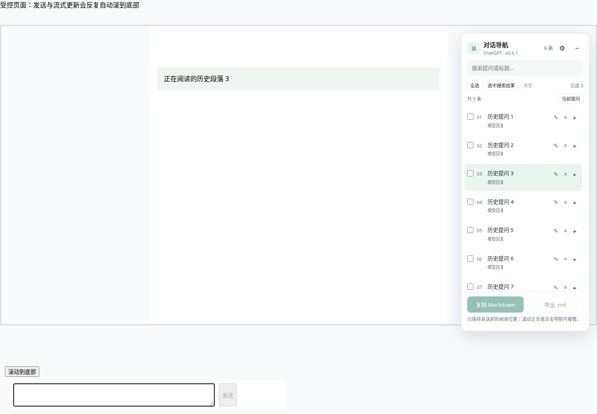
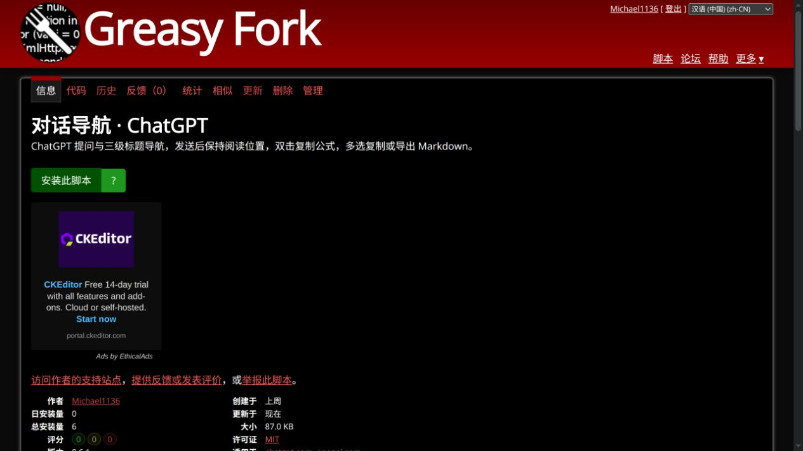

# v0.6.1 发送后保持阅读位置

日期：2026-10-21，Asia/Shanghai。独立分支 `codex/preserve-reading-position`，基于完整 v0.5.0 的 `4bac0de`。本轮按要求提交本地、推送远程功能分支并更新原 Greasy Fork 条目，保留 main。

## 问题与实现

用户正在阅读历史消息时发送新提示词，ChatGPT 的发送及后续回复更新会自动滚到最新消息。v0.5.0 没有发送位置保持逻辑；原来的滚动校正只在点击目录时运行。

补测发现初版0.6.0在“原本无滚动条，发送后首次产生内层溢出”时仍会偏移：原段落480.25px变为310.25px，滚动范围0→170px。原始报告 `artifacts/reading-short-before/report.json`。0.6.1增加祖先滚动链快照，并在有效滚动容器变化时重新绑定和换算锚点坐标。

本版默认开启设置“发送后保持阅读位置”。发送动作发生前保存滚动容器、当前位置、可见内容锚点及其所属消息身份。随后发生自动滚动或布局变化时，按当前锚点恢复阅读位置；锚点失效时使用原滚动坐标，反向列表额外补偿范围变化。

- 覆盖 Enter、发送按钮和表单提交；textarea、contenteditable 及已在真实 ChatGPT 首页只读确认的 `mobile-composer-prompt` / `name=prompt` 输入框均有测试。
- 不阻止提交、不改动提示词或请求，不覆盖网站的滚动 API，不新增权限或依赖。
- 发送后正文仍可生成、目录继续更新；容器替换后寻找当前容器，同一消息重建时使用保存的消息身份重新定位。
- 临时关闭当前容器的浏览器滚动锚定和 CSS 平滑滚动，结束保持时恢复原始行内样式；复制替换过的容器也恢复原始样式。
- 正文滚轮、触摸、滚动按键、滚动条、站点“到底部”按钮、目录点击、切换会话及关闭选项可以交还控制。导航面板自身滚动和编辑输入不被当作正文滚动。
- Shift+Enter、输入法组合输入、空输入、无关表单及“停止生成”按钮不作为新提示词发送。待确认的发送最多等待10秒；新增提问或输入框清空后确认，保持持续到主动接管或切换会话。
- 有历史内容可作参考时才保持；全新空白会话没有历史阅读位置，不会被锁住。若目标历史内容被站点完全删除且原滚动范围也不存在，只能保持当前可达到的位置。

实现位于 `src/reading-position.js`，从 `src/content.js` 接入现有收集、导航及目录整理逻辑。没有读取账户凭据或调用 ChatGPT 私有接口。

## 旧版受控复现

真实 Firefox 安装保存的原 v0.5.0 扩展 ZIP。8轮历史消息中，第3轮段落原先位于滚动视口100px；真实Enter提交1次，新提示词正常加入，模拟站点在发送、追加及4次流式更新中共强制滚底6次。旧版滚动位置从约4185.53px变为16770px，阅读段落偏移从100px变为约-12484.47px。

原始报告：`artifacts/reading-before/report.json`。这个模拟页面用于独立验证浏览器的真实滚动行为，不等同于操作用户私人会话或宣称精确追踪了 ChatGPT 内部框架代码。

## 验收场景

保留此前47组完整功能回归，新增四组：

1. 仅回复可见、前置提问卸载的窗口、初始无滚动条的短会话、正向内层容器、整页滚动、反向列表、contenteditable、移动版输入框及显式平滑滚动；Enter与按钮实际发送且历史段落保持原偏移。
2. 上方内容增高340px、整个滚动容器替换，以及发送5.2秒后的延迟滚底；保持阅读段落的相对位置。
3. 原生PageDown滚动接管、临时样式还原、目录定位、网站到底部按钮和SPA路由切换。
4. Shift+Enter、空输入、复用发送按钮ID的停止按钮、无关表单、关闭开关及刷新持久化。

真实Chrome for Testing / Firefox，分别安装原生扩展和官方Tampermonkey。测试正文为模拟数据及既有脱敏结构；没有向用户的 ChatGPT 会话发送测试消息。输入法组合状态有防护，不把合成事件检查或源码检查说成操作过原生输入法。

```bash
npm ci
npm run build
npm run lint
npm run check:userscript
node tests/run.mjs
TEST_RUNTIME=tampermonkey node tests/run.mjs
npm run package
```

专项调试：

```bash
TEST_ONLY_READING=1 node tests/run.mjs
TEST_RUNTIME=tampermonkey TEST_ONLY_READING=1 node tests/run.mjs
```

完整浏览器版本、最终坐标、发布包哈希、公开升级与远程交付结果见 [JSON记录](verification-0.6.1.json)。

## 最终结果与交付

| 运行形式 | Chrome for Testing 156.0.8078.4 | Firefox 158.0 |
| --- | --- | --- |
| 原生扩展 | 51/51 | 51/51 |
| 官方Tampermonkey | 5.5.1，51/51 | 5.5.0，51/51 |

最终包共 **204/204组通过**。每种环境10个保持位置样本，共40个；段落最终偏移与发送前一致，提示词原内容未改变且每次仅发送1次。另验证接管、关闭开关及此前47组功能。样本为受控数据，不作为任意站点结构下的绝对保证；输入法组合状态有防护但未操作原生IME。

- 本地油猴文件89,120字节，SHA-256 `b8abafe264ace35661dce4fb73ecfa658b3a116b5d4199cebfac97e53863c2a5`。
- 公开文件89,368字节，SHA-256 `f8a28ff22c9a32bdaefb7bef24d7d4205e4955cab2e46da60d9d32d2a7bc47c2`。从普通安装URL下载，去掉平台补入的两行下载/更新URL后与验收文件逐字一致，没有使用带缓存绕过参数的安装URL。
- Chrome从公开页实际升级0.5.0→0.6.1，标题/删除状态保留，H3导航和公式双击Ctrl+V通过。普通历史段落发送前后均99.515625px；短会话首次溢出后均480.25px；各发送1次、经历6次网站滚底尝试及4次流式更新。
- Firefox从普通公开链接安装，官方Tampermonkey管理器显示0.6.1。完整Firefox功能另由51组实际油猴测试覆盖；未向用户私人会话发送消息。
- 发布初期曾短暂拿到旧版0.5.0缓存，未作为成功。等待分发刷新、重新验证普通URL并重跑公开安装后，最终Chrome和Firefox均确认0.6.1。

实现提交 `a207852`，边界修正提交 `352bb02`。代码及本记录推送至 [远程功能分支](https://github.com/Jin-Yi-Liang/chatgpt_plugins/tree/codex/preserve-reading-position)，main保留bf78d3e。网络路径端口22关闭时，使用 [GitHub官方SSH443入口](https://docs.github.com/en/authentication/troubleshooting-ssh/using-ssh-over-the-https-port)，仅命令级设置并保持严格主机密钥校验；未修改凭据、远程URL、全局SSH或系统网络配置。

公开安装验收使用已有HTTP代理，仅配置隔离测试浏览器。完整本地报告在 `artifacts/tests-0.6.1-final/` 和 `artifacts/tests-userscript-0.6.1-final/`，公开报告在 `artifacts/publication-0.6.1/`；仓库JSON保留可复核副本。

实际保持历史位置的受控浏览器截图：



Greasy Fork最终公开版本：


