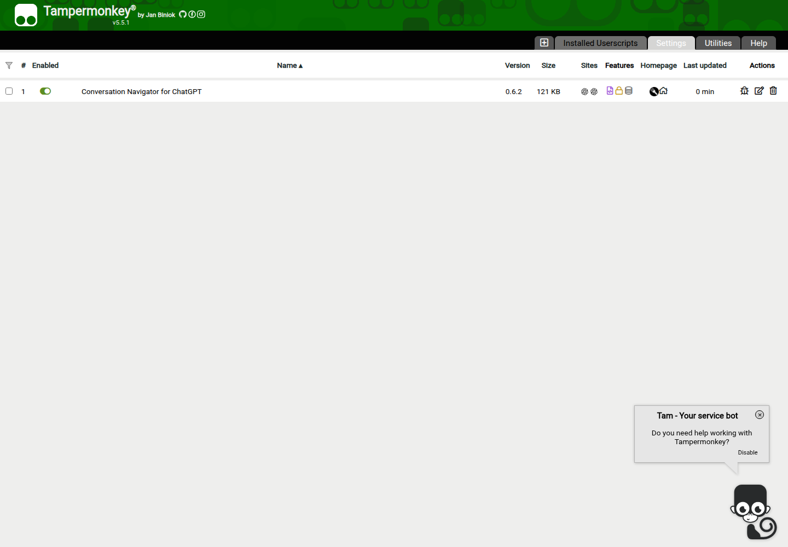

# v0.6.2：流式回复期间手动滚动接管修复

日期：2026-10-27。分支 `codex/streaming-scroll-control`，基于 `4a10672`（v0.6.1）；main 保留 `bf78d3e`。

## 原因与旧版复现

“发送后保持阅读位置”会保存内层滚动容器及其所有可滚动祖先，并在回复更新、重排和自动滚动后恢复原锚点。旧版识别手动滚动时却只接受最初内层容器中的事件，并且无条件排除输入框。用户在外层页面或空输入框边界滚动时，浏览器可能滚动祖先页面，插件仍把该动作当成自动滚动并撤回。此外，document 上的监听可能遗漏被网页其他监听器截断的事件。

真实 Firefox158 安装与 v0.6.1 最终验收哈希完全一致的原生扩展，在模型模拟流式输出的第一段已到达后，用原生滚轮滚动外层页面。旧版 `readingPosition` 仍为 `held`，未交还滚动控制。Chromium 在这项外层变体中没有复现；没有把单浏览器失败描述成两浏览器都失败。

旧版报告：`artifacts/streaming-before/report.json`；其中失败场景不计入新版通过数量。这里确认的是本项目缺陷及受控复现，没有声称读取了 ChatGPT 内部滚动代码。

## 修复行为

- 在 window 捕获阶段接收真实用户意图，早于 document / React 根节点的事件处理。监听保持 passive，不拦截原生滚动及惯性，不修改网站滚动 API。
- 导航面板以外的滚轮、触摸意图可以解除原锚点保持，不再要求事件命中最初的内层容器。后续回复更新不会重新启用已解除的保持。
- 输入框只有确实存在剩余内部滚动空间时才保留正文锚点；到达边界或输入框为空时，允许滚动接管。浏览器缩放手势不作为正文接管。
- 原生滚动条接管检查覆盖保存的各层滚动容器，并检查左右边缘。键盘、目录定位、网站到底部和会话切换继续可用。
- 没有主动操作时，原有“发送后保持当前位置”仍生效。公式复制、三级标题、导航自定义/删除、Markdown复制/导出保留。

生产改动集中在 `src/reading-position.js`，不新增依赖和授权。

## 可重复测试

```bash
npm ci
npm run package
npm run lint
npm run check:userscript
TEST_ARTIFACT_DIR=artifacts/tests-0.6.2-final node tests/run.mjs
TEST_RUNTIME=tampermonkey TEST_ARTIFACT_DIR=artifacts/tests-userscript-0.6.2-final node tests/run.mjs
```

新增两组回归：

1. 回复第一段已经生成、后续内容仍在更新时，分别从正文、外层页面、空输入框边界及被页面截断传播的路径进行真实滚轮操作。验证已解除原锚点保持、坐标实际移动、四次流式更新全部完成、随后不回到原位置，并能向相反方向滚动。
2. 流式期间原生滚动条拖动、导航面板滚轮隔离，以及长草稿输入框内部滚动与边界接管。Chrome 测试显式移除 Playwright 默认的隐藏滚动条参数，以确保实际拖动原生滚动条。

保留此前51组，合计每环境53组。测试使用真实 Chrome for Testing / Firefox 和实际安装的原生扩展或官方 Tampermonkey；正文为受控模拟会话及已有脱敏 DOM。手动接管场景模拟网站收到用户意图后停止自动跟随，但继续输出；插件应立即解除原锚点保持，避免和用户争夺滚动。原有保持测试另行强制滚底，验证无人操作时仍能保持历史位置。

这不等同于在用户已登录的私人 ChatGPT 会话中发送测试消息，也没有宣称操作物理触控板或原生触屏设备。滚轮用浏览器原生输入通道发送，不用合成DOM事件代替。

## 最终验收与发布

| 运行形式 | Chrome for Testing156.0.8078.4 | Firefox158.0 |
| --- | --- | --- |
| 原生扩展 | 53/53 | 53/53 |
| 官方Tampermonkey | 5.5.1，53/53 | 5.5.0，53/53 |

**212/212组通过**。报告 `artifacts/tests-0.6.2-final/report.json`、`artifacts/tests-userscript-0.6.2-final/report.json`；完整副本见 [JSON记录](verification-0.6.2.json)。两份报告的发布包哈希与最终文件核对一致；ZIP内content.js及manifest也逐项与测试文件一致。web-ext lint为0错误/0通知/0警告，用户脚本元信息检查通过，域名及4项授权保持不变。

本地 `.user.js` 为89,804字节，SHA-256 `09ca843594e352c335351abe77f21258ced8af27bf1a9ba40a2bb8c7a0129301`。普通公开安装URL取得90,052字节，SHA-256 `c1b7f980fdba0ec5ab69b3118e9be49e1b481ec9beab2d855de402fc6f848a98`；只去除平台补入的downloadURL和updateURL两行后，与本地验收文件逐字一致。没有使用带缓存绕过参数的安装URL。

Greasy Fork原条目[600317](https://greasyfork.org/zh-CN/scripts/600317-对话导航-chatgpt)已更新为**0.6.2**，原名称和namespace保留。公开浏览器安装验证：

- Chrome真实通过公开安装链接升级0.6.1→0.6.2，标题/删除状态保留；H3导航、公式双击后的Ctrl+V逐字一致、发送后保持位置及首次溢出检查通过。
- 公开脚本在第一段流式输出到达后，真实滚轮从输入区接管，外层页面滚动到220px，保持状态idle；四次回复更新完成后仍在220px，没有恢复原锚点，提交仅1次。
- Firefox通过公开页真实安装至官方Tampermonkey，管理面板显示0.6.2。Firefox本地全部功能另外由53组官方管理器集成测试验证；公开安装步骤不被描述成私有ChatGPT现场测试。

原始凭证在 `artifacts/publication-0.6.2/`。IAB发布页的截图接口返回不可用，因此截图采用实际公开升级后的Chrome管理面板；没有把本地模拟图作为发布页截图。线上版本另由页面版本字段与普通安装文件核实。



修复提交 `150b3098f48f18df7fe2204bc4020372325eac86` 已推送 `codex/streaming-scroll-control`，发布证据在同分支提交。main保留 `bf78d3e941e5e49e7cf9acf5d87f019fe15ad594`。Git使用现有SSH身份，经每条命令指定的ssh.github.com:443传输并严格校验主机，不修改origin地址、全局SSH或网络配置。
